# Ad Shield

An open-source ad and pop-up blocker for Brave and other Chromium browsers.
It has two parts that work together, and either one also works on its own:

- **Filter list** (`filters/ad-shield.txt`): rules for Brave Shields' built-in engine, also usable in uBlock Origin and AdGuard. It blocks ad loaders and ad frames and hides ad containers. Because the browser's own engine applies it, it has none of Manifest V3's limits, and it updates itself from its subscription URL.
- **Extension** (Manifest V3): catches what lists cannot know about in advance:
  - invisible click traps
  - pop-unders and tab-unders
  - links rewritten after the page loads

  It **leaves genuine pop-ups alone**, such as sign-in, payment and sharing windows.

## Installation

### 1. Filter list (recommended for everyone)
1. Open `brave://settings/shields/filters`.
2. Under **Add custom filter lists**, paste this URL and click **Add**:
   `https://raw.githubusercontent.com/didierdrogba146-blip/ad-shield/main/filters/ad-shield.txt`

In uBlock Origin, use *Dashboard → Filter lists → Import*. In AdGuard, use *Filters → Custom → Add custom filter*.

### 2. Extension
1. Download or clone this repository.
2. Open `brave://extensions` (or `chrome://extensions`).
3. Turn on **Developer mode** in the top-right corner.
4. Click **Load unpacked** and select the repository folder.

### 3. Recommended Brave settings
- `brave://settings/shields`: set *Trackers & ads blocking* to **Aggressive**.
- `brave://settings/shields/filters`: turn on **Fanboy's Annoyances + uBO Annoyances** and **AdGuard URL Tracking Protection**. Keep your regional list on (for Turkish sites, *AdGuard Turkish* is on by default).

## How the extension works
| Layer | File | What it does |
|---|---|---|
| Network | `rules.json` | Blocks ad networks, first-party ad folders, pay-per-click shorteners and gambling domains that keep reappearing under new numbers |
| Page | `cosmetic.js`, `cosmetic.css` | Hides ad slots; finds and removes invisible full-screen overlays and passes the click through to what was underneath; sends tampered links to their original address |
| Tab | `background.js` | Judges every new tab and tab redirect against your last click, then closes or reverts the ones that are ads |

**Allowed:**
- Sign-in, payment and sharing providers
- Windows opened from the same site
- The destination of the visible link you clicked
- "Open link in new tab" from the right-click menu
- Windows opened by a real button on the page
- Tabs you open yourself (Cmd/Ctrl+T, bookmarks, the address bar)

**Blocked:**
- Cross-site tabs opened without a click
- Tabs opened by a click on an invisible overlay
- Clicking a link to one place opening somewhere else (pop-under)
- New tabs that push themselves behind the current page
- Tiny or off-screen windows
- Tab-unders
- Windows that a button inside an embedded player opens on another site

The extension popup lists every blocked pop-up on the current tab with an **Open** button. It also has two per-site switches: **Allow pop-ups on this site** and **Turn shield off for this site**.

## Why ad blockers fall short
Techniques found through reverse engineering on real streaming sites:

1. **First-party ads.** Blockers block domains from ready-made lists. Ads served from a folder on the site's own domain never show up in those lists, and Brave Shields does not block first-party ads in its default mode.
2. **Obfuscated loaders.** The ad script is hidden inside `eval(atob('...'))`, so content matching fails.
3. **Bot detection.** The script shows no ads to headless browsers or `navigator.webdriver`, so the automated browsers that filter-list maintainers use never see them.
4. **Delayed start.** On a first visit, ads wait 15 minutes before appearing.
5. **Fooling the browser's pop-up blocker.** Browsers only block windows opened without a click. The site lays a nearly invisible layer over the whole page, which turns every click into a "real" one.
6. **Redirect chains and rotating domains.** Ad destinations pass through link shorteners, and gambling domains come back under a new number as soon as they are blocked.
7. **Manifest V3 limits.** Extensions hand the browser a fixed set of rules with a size cap, and lists only refresh with an extension update. This is why the filter list matters: Brave's own engine has no such limits.

Academic work (USENIX Security 2019, "click interception") groups click hijacking into three techniques:
- invisible overlays
- oversized links covering the page
- link addresses rewritten after load

The extension detects all three by behaviour rather than by list.

## Test results
Each page was scrolled to the bottom, and visible ad frames and completed ad requests were counted.

| Setup | 7 major news sites | 2 streaming sites |
|---|---|---|
| Brave Shields (default) | 1 ad frame, 2 ad slots | 18 ad frames, 78 ad requests, 8 ad tabs on 4 clicks each |
| Shields + filter list only (no extension) | — | 0 ad frames, 0 ad requests, 0 ad tabs |
| Shields + Ad Shield extension | 0 | 0 |
| Aggressive + extra lists + Ad Shield | 0 | 0 |

- **Google/Amazon ad scripts:** the remaining "completed" requests for them are Brave's local stand-in scripts (5 KB and 2 KB, served without a network connection), not the real ones.
- **Popular sites:** on 13 popular sites (search, video, shopping, news, government, social), the extension blocked only ad and tracking requests, never the page or anything it needs.

Local scenario tests (18 scenarios):
- **Opened:** sign-in pop-ups, normal links, same-site windows, user-opened tabs, deliberate clicks on download shorteners
- **Blocked:** invisible overlays, tiny windows, pop-unders, tampered links, tab-unders
- **Logged:** blocked pop-ups appear in the popup with an **Open** button
- **Click preservation:** a click on an overlay reaches the button underneath in one go
- **Not passing (pop-under + link):** the browser's own one-pop-up-per-click rule also stops the clicked link; this happens without the extension too.

## Known limitations
- If a site renames its ad folder, the network rule and the filter list need an update. Overlay, pop-up and tab-under protection is behaviour-based and unaffected.
- The gambling-domain pattern also blocks typing those addresses yourself.
- Click preservation cannot click into a cross-origin frame (such as a video player). The overlay is gone, so your next click reaches it.

## Changelog
**1.3.0**
- New: filter list for Brave Shields, uBlock Origin and AdGuard (`filters/ad-shield.txt`).
- New: blocked pop-ups are listed in the popup with an **Open** button, plus a per-site **Allow pop-ups** switch.
- New: pop-under detection for real buttons (a new tab that pushes itself behind the page is closed).
- New: click preservation: a click on an invisible overlay goes through to what is underneath.
- New: overlays styled through stylesheet classes are found by probing the page.
- Fix: one shared definition of "same site" (`domain.js`); `.com.tr` / `.co.uk` sites were handled inconsistently.
- Fix: each new tab is judged once (counts were doubled).
- Fix: pay-per-click shorteners open when you click them on purpose.
- Fix: reverting a hijacked tab now goes back in history instead of reloading the page.
- Fix: the badge counter survives browser restarts.
- Fix: the menu-backdrop exception no longer lets overlays named "modal" through.

**1.2.0**
- Fix: tabs the user opens were closed as ads.
- Fix: general link shorteners, right-click "Open link in new tab" and clickable cards were treated as ads.
- Fix: menu backdrops were mistaken for click traps.
- Removed an overly broad network rule.

## License
Public domain ([The Unlicense](LICENSE)). Copy, modify and distribute it freely; no copyright is claimed.
